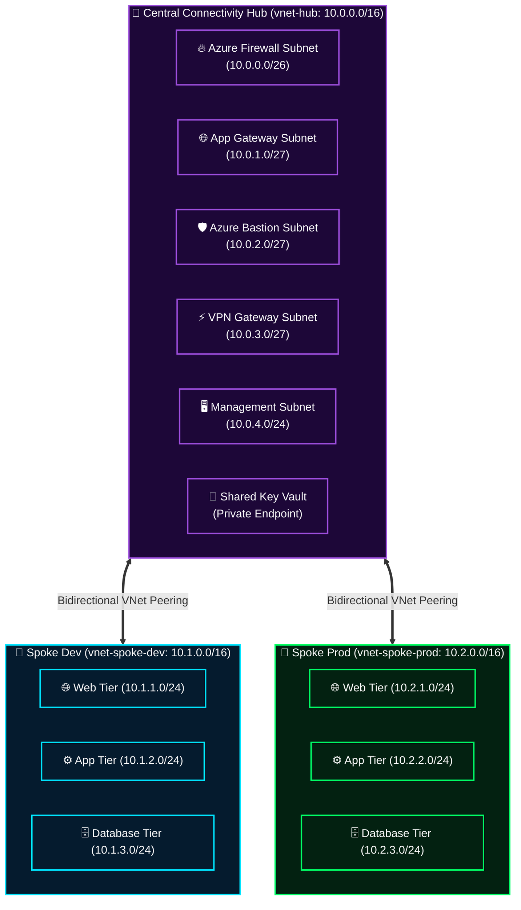

<div align="center">

# 🕸️ Azure Enterprise Hub-and-Spoke Infrastructure
### Production-Grade Network Topology & CAF Segmentation via Terraform

[](https://azure.microsoft.com)
[](https://terraform.io)
[](https://www.checkov.io)
[](#-state-isolation-strategy)

**Designed by [Mihir Maurya](https://github.com/MihirMaurya-dev) · Enterprise Cloud Architect & DevSecOps**

</div>

---

## 🏗️ Architectural Topology

This repository delivers an enterprise-grade **Hub-and-Spoke Network Architecture** aligned with the **Microsoft Cloud Adoption Framework (CAF)**. It isolates shared connectivity and security appliances inside a centralized Hub VNet, while segmenting application workloads into dedicated Spokes (`Dev` and `Prod`) connected via low-latency Virtual Network Peering.



---

## 📊 IP Addressing & CIDR Allocation Plan

| Network Zone | Resource | CIDR Block | Usable IPs | Purpose / Security Role |
|---|---|---|:---:|---|
| **Hub VNet** | `AzureFirewallSubnet` | `10.0.0.0/26` | 59 | Central egress/ingress TLS inspection |
| **Hub VNet** | `ApplicationGatewaySubnet` | `10.0.1.0/27` | 27 | Layer 7 reverse proxy & WAF v2 |
| **Hub VNet** | `BastionSubnet` | `10.0.2.0/27` | 27 | Zero public IP jumpbox access |
| **Hub VNet** | `GatewaySubnet` | `10.0.3.0/27` | 27 | VPN & ExpressRoute hybrid connectivity |
| **Hub VNet** | `ManagementSubnet` | `10.0.4.0/24` | 251 | Jump hosts, build runners & telemetry |
| **Spoke Dev** | `vnet-spoke-dev` | `10.1.0.0/16` | 65,531 | Development environment workload space |
| **Spoke Prod** | `vnet-spoke-prod` | `10.2.0.0/16` | 65,531 | Production mission-critical workloads |

---

## 📂 Repository File System Architecture

```text
HUB-SPOKE/
├── azure-pipelines.yml       # 🔄 Azure DevOps Multi-Stage CI/CD pipeline
├── run-pipeline.ps1          # 🛠️ Shift-Left Checkov + Terraform execution harness
└── terraform/
    ├── environments/         # 🚀 ROOT DEPLOYMENTS (Decoupled State Backends)
    │   ├── hub/              # Central Hub: VNet, VPN Gateway, Key Vault
    │   ├── spoke-dev/        # Dev Workload VNet & Peering to Hub
    │   └── spoke-prod/       # Prod Workload VNet & Peering to Hub
    │
    └── modules/              # 🧩 REUSABLE TERRAFORM MODULES
        ├── key_vault/        # Private Key Vault with RBAC & Access Policies
        ├── network/          # Dynamic VNet/Subnet generator via for_each
        └── vpn/              # Enterprise Gateway & P2S / S2S VPN
```

---

## 🔒 Security & Shift-Left DevSecOps Gates

Every infrastructure change in this repository is strictly governed before merge:

1. **Static Analysis & CIS Benchmark (Checkov)**:
   - Scans all Terraform modules for non-compliant configurations (e.g., exposed storage accounts, unencrypted disks, permissive NSGs).
2. **Zero Blast-Radius State Decoupling**:
   - Each environment (`hub`, `spoke-dev`, `spoke-prod`) maintains its own isolated Terraform state file in Azure Blob Storage with lease-locking. A failure in `spoke-dev` can never corrupt or lock `spoke-prod`.
3. **Plan Artifact Verification**:
   - Deployments strictly consume immutable compiled `.tfplan` files to guarantee that what was approved in CI is exactly what is applied in CD.

---

## ⚡ Local Pipeline Simulation Harness (`run-pipeline.ps1`)

To test the entire deployment lifecycle locally prior to committing to Azure DevOps:

```powershell
# 1. Authenticate with Azure CLI
az login

# 2. Run the automated DevSecOps simulator
.\run-pipeline.ps1
```

The harness automatically executes:
- Checkov vulnerability scanning with threshold suppression
- `terraform init -upgrade` & provider lockfile verification
- `terraform fmt -check` & `terraform validate`
- `terraform plan -out main.tfplan` generation

---

<div align="center">

**[Explore Portfolio](https://b18g119.online)** · **[Connect on LinkedIn](https://linkedin.com/in/mihirmauryaa)** · **[DevOps Knowledge Vault](https://github.com/MihirMaurya-dev/DevOps-Notes)**

</div>
